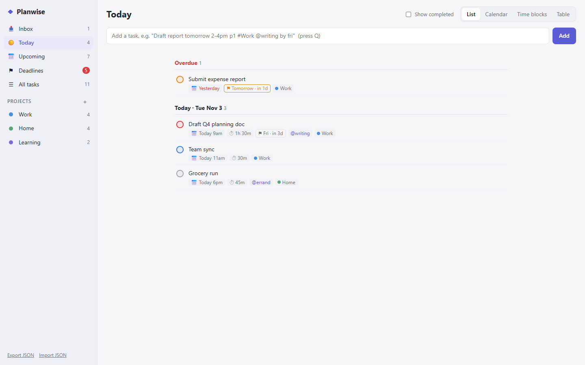
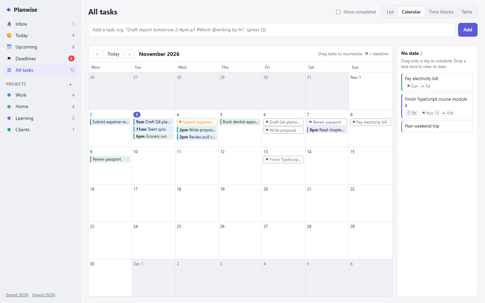
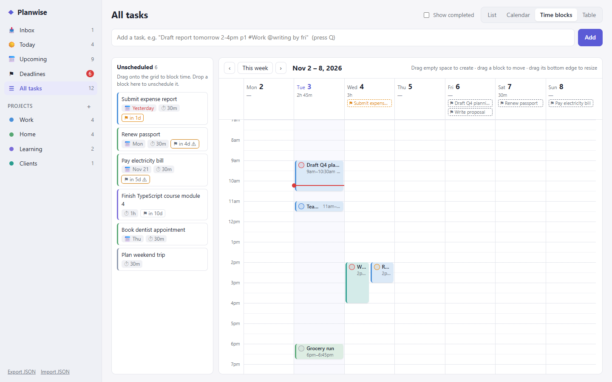
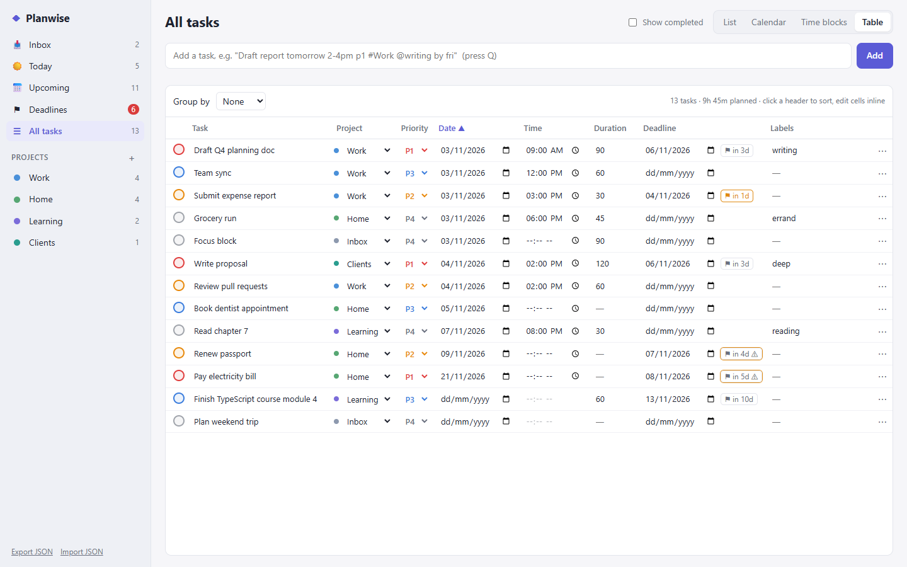

# Planwise

[](https://github.com/YOUR-USERNAME/planwise/actions/workflows/ci.yml)
[](LICENSE)

**A local-first task planner built around scheduling: deadlines, a calendar, time blocking and a table layout.**

Planwise runs entirely in the browser with no build step, no dependencies and no account. Type tasks in plain language
("Draft report tomorrow 2-4pm p1 #Work by fri"), then plan them on a month calendar or drag them into time blocks on a
weekly timeline. Your data stays in `localStorage` and can be exported or imported as JSON.

**Live demo:** [https://YOUR-USERNAME.github.io/planwise/](https://YOUR-USERNAME.github.io/planwise/) <!-- TODO: replace YOUR-USERNAME once GitHub Pages is enabled -->

## Screenshots

| List | Calendar |
|---|---|
|  |  |
| **Time blocks** | **Table** |
|  |  |

## Run locally

No install is needed. Either open `index.html` directly in a browser, or serve the folder with any static server:

```sh
git clone https://github.com/YOUR-USERNAME/planwise.git
cd planwise
npx serve .            # or: python -m http.server 8000
```

## Features

| Feature | What it does |
|---|---|
| **Deadlines** | Separate from the scheduled date. The ⚑ badge shows days left (orange ≤ 2 days, red when missed), ⚠ when the task is scheduled *after* its deadline, plus a dedicated **Deadlines** view and nav alert. |
| **Calendar** | Month grid with tasks and deadline flags. Drag tasks between days, drag a ⚑ to move a deadline, drag from the *No date* tray to schedule, drop onto the tray to clear the date. |
| **Time blocks** | Week timeline (15-min snap). Drag unscheduled tasks onto the grid, drag blocks to move them across days and times, drag a block's bottom edge to resize, drag empty space to create a new block, drop a block on the tray to unschedule it. Overlaps sit side by side, each day header shows planned hours, and a red line marks the current time. |
| **Table** | Spreadsheet-style inline editing (title, project, priority, date, time, duration, deadline, labels), sort by any column, group by project or priority, with a planned-time total. |

Also included: projects, priorities P1–P4, labels, notes, a "show completed" toggle, and light and dark themes that follow your system setting.

## Quick add syntax

```
Draft report tomorrow 2-4pm p1 #Work @writing by fri
```

| Token | Examples |
|---|---|
| Date | `today`, `tomorrow`, `fri`, `next monday`, `in 3 days`, `nov 12`, `12/25`, `2026-12-01` |
| Time | `3pm`, `at 9:30am`, `15:00` |
| Time range (sets duration) | `2-4pm`, `11-1pm`, `9:30 to 11am`, `14:00-15:30` |
| Duration | `for 45m`, `for 1.5h`, `for 1h 30m` |
| Deadline | `by fri`, `deadline dec 15`, `{nov 30}` |
| Priority / project / label | `p1`, `#Work` (created if missing), `@errand` |

A chip preview under the input shows what was recognized.

Keyboard: `Q` focuses quick add, `1`–`4` switch layouts. URL hashes `#list #calendar #timeblock #table` also select the layout.

## Tests

Unit tests cover the quick-add parser and date helpers. They need only Node.js 18+ and run in CI on every push and pull request:

```sh
npm test
```

The end-to-end test drives the real app in headless Chrome with `puppeteer-core`, exercising quick add, calendar
drag-and-drop, time-block move/resize/create, and inline table editing. It fails on any console error or warning.

```sh
npm install            # installs puppeteer-core (dev dependency)
npm run test:e2e
```

- Chrome is found automatically in the usual Windows, macOS and Linux install locations. Set `CHROME_PATH` to use a
  different Chrome, Chromium or Edge binary.
- Screenshots are written to `test-results/screenshots/` (gitignored). You can pass a different app folder and
  screenshot folder: `node test/e2e.js <app-dir> <screenshot-dir>`.
- The images in `docs/screenshots/` come from this run, in the light theme.

## Deploying to GitHub Pages

`.github/workflows/pages.yml` publishes the static app on every push to `main`. Enable it once in the repository:
**Settings → Pages → Build and deployment → Source: GitHub Actions**. Then replace `YOUR-USERNAME` in the links above.

## License

[MIT](LICENSE)
